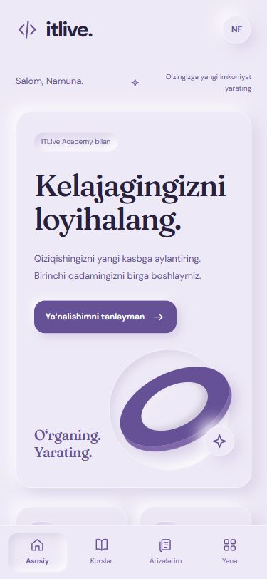
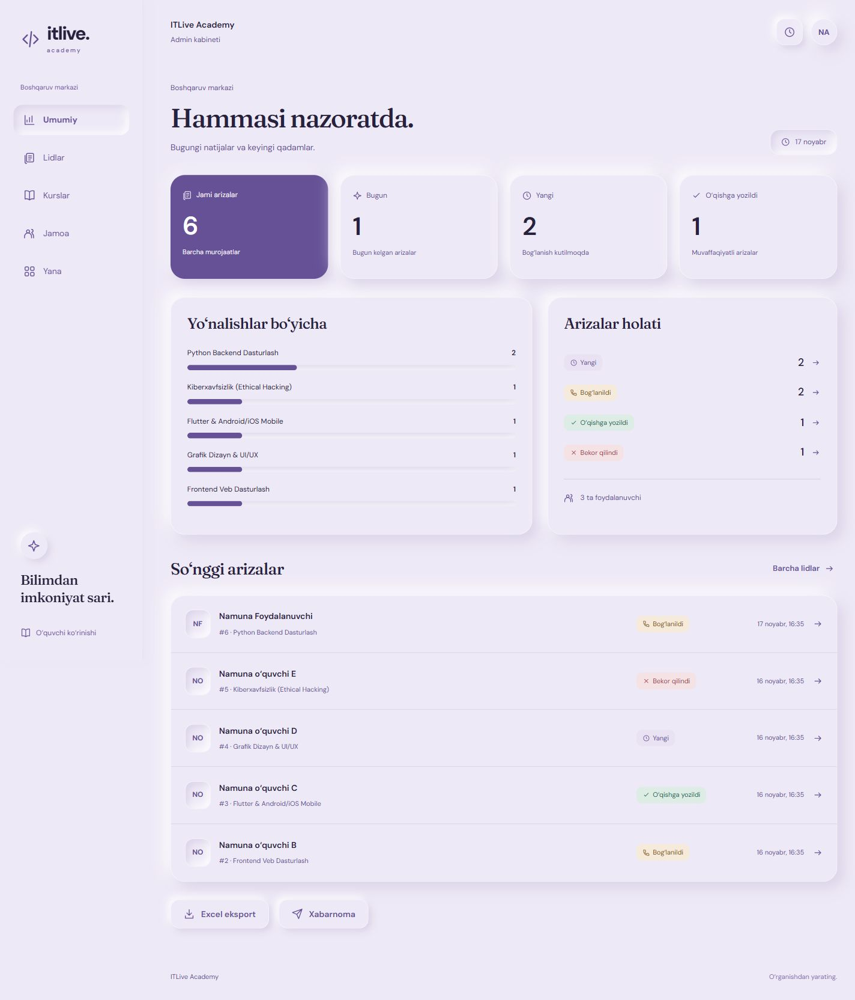

# ITLive Academy — Telegram Bot + Mini App

ITLive o‘quv markazining aiogram boti va Telegram Mini App. Tanlangan **Studio / Neumorphism** dizayni: avvalgi binafsha ranglar, Fraunces / DM Sans shriftlari, yumshoq bo‘rtma kartalar va botiq boshqaruvlar.

Bot, API va frontend bitta Python servisida ishlaydi; hammasi bir SQLite bazasidan foydalanadi. Railway uchun Docker image, dependency lock va doimiy volume yo‘riqnomasi tayyor.

## Railway’ga joylash

**[To‘liq Railway yo‘riqnomasi](docs/railway-deploy.md)** — GitHub repo, `/data` volume, Variables, domen va Telegram menyusini ulash.

Tez sozlamalar:

| Sozlama | Qiymat |
|---|---|
| Source | Shu repo, `main`, repo ildizi |
| Build | `Dockerfile` avtomatik aniqlanadi |
| Start | `python run.py` |
| Healthcheck | `/healthz` |
| Replicas | `1` |
| Volume | `/data` |
| Zarur Variables | `BOT_TOKEN`, `ADMINS`, `APP_URL` |
| Baza | `/data/itlive_bot.db` |

`.railway/railway.ts` — CLI orqali IaC sozlamasi uchun qo‘shimcha yo‘l. GUI orqali joylashda Node build kerak emas. Amaldagi Railway hujjatiga mos ravishda eskirgan `railway.json`ga tayanilmaydi.

## Imkoniyatlar

| Foydalanuvchi | Sotuvchi | Admin |
|---|---|---|
| Kurslar, tafsilotlar va narxlar | Umumiy statistika | Barcha statistika va foydalanuvchilar soni |
| Kursga / bepul darsga ariza | Lid qidirish, filtr, sahifalash | Lidlar va Excel `.xlsx` eksport |
| Telefon va lokatsiya ulashish | Mijozga telefon / Telegram orqali chiqish | Kurs yaratish, tahrirlash, yashirish, o‘chirish |
| Shaxsiy arizalar va holatlar | Holat va sotuvchi izohini saqlash | Sotuvchi qo‘shish va kirishini bekor qilish |
| 5 savolli kasb testi | O‘quvchi ko‘rinishi | Matn, rasm, video bilan ommaviy xabarnoma |
| Mentorlar, FAQ, markaz va aksiyalar | Profil | Xabarnoma navbati, natijasi, to‘xtatish |
| Kontaktlar, Google / Yandex xarita | | Markaz sozlamalari va fikrlar ro‘yxati |
| Fikr va taklif yuborish | | Excelni yuklab olish yoki o‘z Telegramiga yuborish |

Admin `ADMINS` orqali, sotuvchi faol `sales_team` yozuvi orqali aniqlanadi. Oddiy foydalanuvchi faqat o‘z arizalarini ko‘radi; ichki sotuvchi izohlari unga uzatilmaydi. Har bir API so‘rovida ruxsat serverda qayta tekshiriladi.

Yangi arizalar, fikrlar va holat o‘zgarishlari bot orqali bildiriladi. Ariza va ommaviy xabarnoma takroriy yuborishdan himoyalangan. Ommaviy xabarnoma yuborishdan oldin matn, media va qabul qiluvchilar soni ko‘rsatiladi.

## Lokal ishga tushirish

Python 3.12 tavsiya etiladi:

```powershell
python -m venv .venv
.\.venv\Scripts\python -m pip install -r requirements.lock
Copy-Item .env.example .env
```

Agar `.env` mavjud bo‘lsa nusxalash qadamini o‘tkazib yuboring. Uning ichida haqiqiy `BOT_TOKEN`, `ADMINS` va Telegram uchun ochiq HTTPS `APP_URL`ni belgilang, keyin:

```powershell
.\.venv\Scripts\python run.py
```

`run.py` bot polling, API, frontend va xabar navbatlarini birgalikda boshqaradi. `bot.py` avvalgi mustaqil bot rejimi uchun ham qolgan; bir token bilan ikkalasini bir vaqtda ishga tushirmang.

## Botga ulanmasdan dizaynni lokal sinash

```powershell
.\.venv\Scripts\python scripts/preview_local.py
```

Terminal admin, sotuvchi va foydalanuvchi uchun lokal URL chiqaradi. Ular alohida vaqtinchalik namuna bazasida ishlaydi, haqiqiy `.env` yoki botga ulanmaydi va hech kimga Telegram xabari yubormaydi. Bu skript production Docker image’iga kiritilmaydi. Production API’da demo login endpoint yo‘q.

## Testlar

```powershell
.\.venv\Scripts\python -m pip install -r requirements-dev.txt
.\.venv\Scripts\python -m pytest
```

37 ta test autentifikatsiya, rollar, begona arizalar maxfiyligi, validatsiya, idempotency, parallel tahrir konflikti, kurslar, sozlamalar, feedback, kasb testi, Excel, media, xabarnoma navbatlari va bot startup/shutdown’ini tekshiradi. Testlar haqiqiy mijozlar bazasidan foydalanmaydi.

**[Tekshiruv hisoboti](docs/studio-neumorphism-validation.md)** va **[dizayn qarorlari](docs/studio-neumorphism-design.md)**.

## Tuzilishi

```text
run.py                # Railway / lokal: API + bot + background workerlar
bot.py                # aiogram dispatcher va mustaqil bot rejimi
config.py             # Muhit sozlamalari
webapp/               # FastAPI, Telegram auth, validatsiya, tranzaksiyalar, navbatlar
miniapp/app/          # Studio neumorphism frontend, lokal shriftlar va SVG ikonlar
database/             # Bot bilan umumiy SQLite repository
handlers/             # Telegram botning mavjud funksiyalari
scripts/              # Lokal namuna va izchil SQLite backup
tests/                # Izolyatsiyalangan API va worker testlari
.railway/             # Ixtiyoriy, tekshirilgan TypeScript IaC
Dockerfile            # Python 3.12 image
requirements.lock     # Sinovdan o‘tgan runtime versiyalari
```

`.env`, baza, yuklangan media va eksportlar GitHub’ga kirmaydi. Telegram bot tokeni frontendga uzatilmaydi. Sessiya tokenlari brauzerning doimiy saqlash joyiga yozilmaydi, serverda faqat hash saqlanadi.

Oldingi olti dizayn ko‘rgazmasi `miniapp/design-preview` ichida arxiv sifatida saqlangan; ishlaydigan yangi ilova `miniapp/app` va `webapp` ichida.




