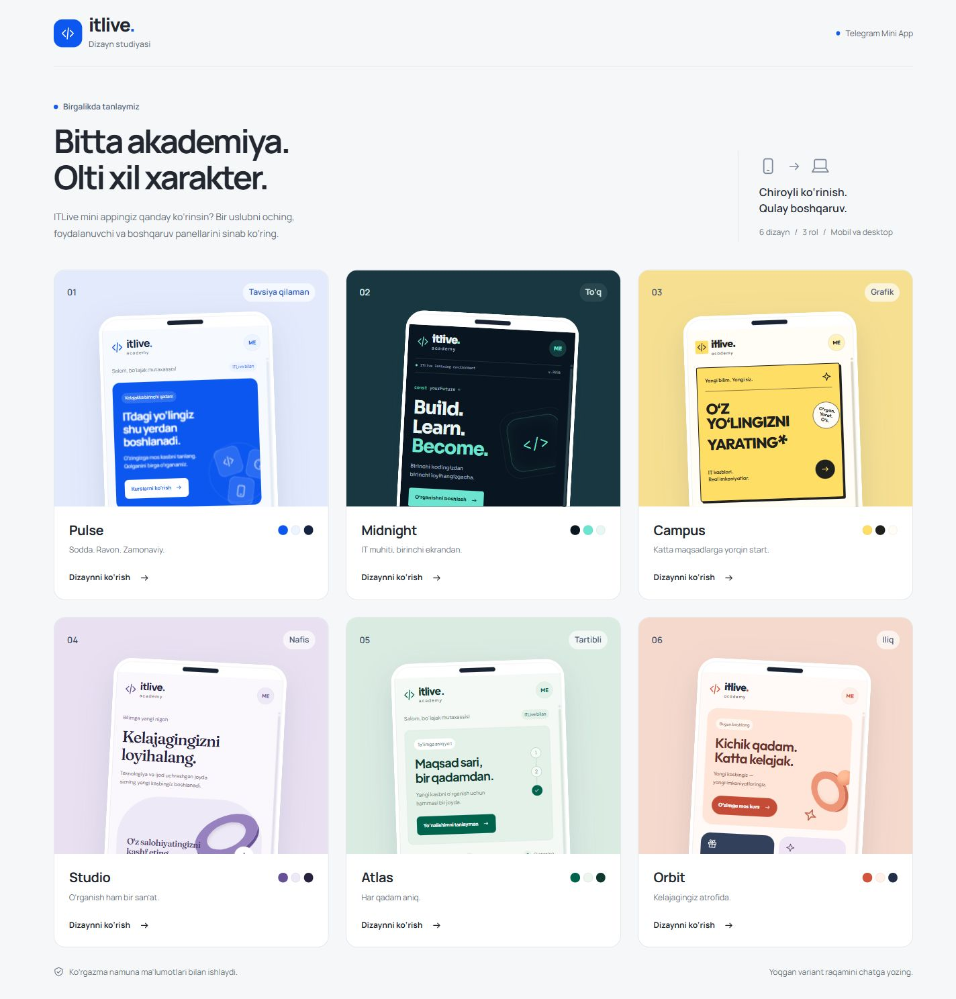

# 🚀 ITLive O'quv Markazi — Professional Telegram Boti

Ushbu bot **ITLive o'quv markazi** uchun maxsus ishlab chiqilgan bo'lib, o'quv markaziga murojaat qilgan yangi mijozlar (lidlar) ma'lumotlarini qabul qilib, ularni darhol **sotuvchilar (sales team)** profillariga yetkazib beradi hamda markaz faoliyatini to'liq avtomatlashtiradi.

---

## 🛠 Texnologiyalar va Kutubxonalar
- **Python 3.10+**
- **Aiogram 3.13+** (Zamonaviy asinxron Telegram Bot freymvorki, Router va FSM arxitekturasi)
- **SQLite & aiosqlite** (To'liq asinxron, ishonchli va yengil ma'lumotlar bazasi)
- **OpenPyXL** (Murojaatlarni zamonaviy rangli Excel (.xlsx) formatida eksport qilish)
- **Python-dotenv** (Konfiguratsiya va xavfsizlikni boshqarish)

---

## ✨ Imkoniyatlar va Funksiyalar (12+ Funksiya)

### 👤 1. Foydalanuvchilar uchun imkoniyatlar:
1. 📝 **Kursga yozilish (Lid yig'ish tizimi):**
   - Ism va familiya (tekshiruv bilan)
   - Telefon raqam (bitta tugma orqali yuborish yoki xalqaro formatda kiritish)
   - Yoshi (7 dan 90 gacha tekshiruv bilan)
   - Qayerdanligi / Hudud (Toshkent, viloyatlar yoki geo-lokatsiya yuborish)
   - Qiziqqan IT yo'nalishi (mavjud kurslar ro'yxatidan tanlash)
   - Qulay o'qish vaqti (Ertalab, Tushdan keyin, Kechki yoki Farqi yo'q)
2. 📚 **Kurslarimiz:**
   - Barcha faol kurslar ro'yxati (Python, Frontend, Flutter, Dizayn, Kiberxavfsizlik, Foundation, SMM)
   - Har bir kurs haqida batafsil ma'lumot (davomiyligi, oylik to'lovi, dastur texnologiyalari va bevosita yozilish tugmasi)
3. 🎁 **Bepul sinov darsiga yozilish:**
   - Markazga tashrif buyurib 1-ochiq darsda bepul qatnashish uchun tezkor ariza
4. 💡 **IT Kasb tanlash testi (Interactive Career Quiz):**
   - 5 ta qisqa va qiziqarli savol orqali foydalanuvchining mantiqiy, vizual va texnik qobiliyatini tahlil qilib, unga eng mos IT yo'nalishini aniqlab beruvchi intellektual test
5. 📍 **Bizning lokatsiya:**
   - Telegram orqali jonli geo-manzil nuqtasi
   - Aniq manzil, mo'ljal va ish vaqtlari
   - Google Maps va Yandex Xarita havolalari
6. 📞 **Bog'lanish va Raqamlar:**
   - Call-markaz telefonlari, Telegram admin, rasmiy veb-sayt, Instagram va YouTube havolalari
7. ℹ️ **Biz haqimizda (ITLive haqida):**
   - O'quv markazining afzalliklari, noutbuklar, coworking, karyera markazi va xalqaro sertifikat haqida ma'lumot
8. 👨‍🏫 **Mentorlarimiz:**
   - Senior va Lead darajadagi tajribali dasturchi ustozlar va ularning real loyihalari
9. 🏷 **Chegirmalar va Aksiyalar:**
   - Do'stingni olib kel aksiyasi, 100% to'lov keshbeki va boshqa maxsus chegirmalar
10. ❓ **FAQ (Savol-javoblar):**
    - Boshlang'ich bilim kerakmi, noutbuk beriladimi, ishga joylashish qanday bo'ladi kabi barcha dolzarb savollarga javoblar
11. ✍️ **Fikr va takliflar:**
    - Foydalanuvchilar o'z fikr va takliflarini qoldirishi mumkin, xabar darhol barcha adminlarga yetib boradi
12. 📂 **Mening arizalarim:**
    - Foydalanuvchi o'zi qoldirgan barcha arizalar holatini (Yangi, Bog'lanildi, O'qishga yozildi) real-vaqt rejimida kuzatib boradi

---

### 💼 2. Sotuvchilar (Sales Team) uchun tizim:
- Markazga yangi ariza tushgan zahoti barcha biriktirilgan sotuvchilar profiliga **ovozli bildirishnoma bilan maxsus karta** yuboriladi:
  - Mijoz ismi, tozalangan telefon raqami, yoshi, hududi, kursi, vaqti va Telegram profili.
- Sotuvchi bevosita Telegram ichidan turib bitta tugma orqali holatni o'zgartiradi:
  - `[📞 Bog'lanildi]`
  - `[✅ O'qishga yozildi]`
  - `[❌ Bekor qilindi]`
  - `[💬 Izoh yozish]` (mijoz bilan bo'lgan suhbat tafsilotini bazaga yozib qo'yish)
- `/sales` yoki "💼 Sotuvchi Kabineti" orqali kunlik arizalar va statistikasini ko'rish.

---

### 👑 3. Moslashuvchan va Dinamik Admin Panel:
Admin paneli botni kodiga kirmasdan Telegram orqali boshqarish imkonini beradi:
- 📊 **To'liq Statistika:**
  - Jami foydalanuvchilar, bugungi va umumiy lidlar, statuslar bo'yicha tahlil, eng ommabop TOP kurslar
- 📥 **Lidlar boshqaruvi va 📑 Excel eksport:**
  - Barcha murojaatlarni chiroyli formatlangan, rangli statuslar bilan jihozlangan `.xlsx` (Excel) fayl ko'rinishida bitta tugma bilan yuklab olish
- 📚 **Kurslarni dinamik boshqarish (CRUD):**
  - Yangi kurs qo'shish (nomi, narxi, muddati, tavsifi, texnologiyalari)
  - Kurslarni yoqish / vaqtincha o'chirish / butunlay o'chirish
- 👥 **Sotuvchilarni boshqarish:**
  - Yangi sotuvchi qo'shish (Telegram ID, ism, raqam)
  - Sotuvchini o'chirish (o'chirilgan xodimga lidlar bormaydi)
- 📢 **Ommaviy Xabarnoma (Broadcast):**
  - Barcha bot a'zolariga rasm, video yoki matnli xabarlarni xavfsiz (anti-flood) yuborish
- ⚙️ **Bot sozlamalarini dinamik o'zgartirish:**
  - Telefon raqamlar, manzil, mo'ljal, ish vaqti, Instagram, veb-sayt, "Biz haqimizda" va chegirmalar matnlarini Telegramning o'zidan o'zgartirish

---

## 📁 Loyiha Tuzilishi

```
d:\itlivebot admin\
├── bot.py                  # Asosiy ishga tushirish fayli
├── config.py               # Muhit o'zgaruvchilari va default sozlamalar
├── .env                    # Bot token va Admin ID lari saqlanadigan fayl
├── requirements.txt        # Kerakli Python kutubxonalari
├── database/
│   ├── __init__.py
│   ├── db.py               # Asinxron SQLite connection va jadvallar
│   └── models.py           # SQLite CRUD operatsiyalari
├── handlers/
│   ├── __init__.py
│   ├── user_handlers.py    # Asosiy 12+ funksiyalar
│   ├── registration.py     # Lid qabul qilish va sotuvchilarga yuborish
│   ├── sales_handlers.py   # Sotuvchilar harakatlari va izohlar
│   ├── quiz.py             # IT Kasb tanlash testi
│   ├── feedback.py         # Fikr va takliflar
│   ├── admin_handlers.py   # Admin panel, statistika, Excel, xabarnoma
│   ├── admin_courses.py    # Kurslarni boshqarish
│   └── admin_sales.py      # Sotuvchilarni boshqarish
├── keyboards/
│   ├── reply.py            # Asosiy menyu, raqam va lokatsiya tugmalari
│   └── inline.py           # Inline tugmalar (kurslar, admin, quiz, lidlar)
├── middlewares/
│   └── user_tracker.py     # Foydalanuvchilarni avtomatik ro'yxatga oluvchi middleware
├── states/
│   └── user_states.py      # FSM holatlari
├── utils/
│   ├── excel_export.py     # Lidlar ro'yxatini Excelga eksport qilish
│   └── text_helpers.py     # Shablolar va yordamchi matnlar
└── data/                   # SQLite bazasi va Excel hisobotlar saqlanadigan joy
```

---

## 🚀 Ishga Tushirish Qo'llanmasi

1. **Kutubxonalarni o'rnatish:**
   ```bash
   pip install -r requirements.txt
   ```

2. **`.env` faylini to'ldirish:**
   `.env.example` faylidan `.env` nusxasini yarating va bot tokeningiz hamda o'zingizning Telegram ID raqamingizni kiriting. `.env`, lokal ma'lumotlar bazasi va eksportlar GitHub'ga yuklanmaydi:
   ```env
   BOT_TOKEN=1234567890:ABCdefGhIJKlmNoPQRstuVWXyz
   ADMINS=123456789
   DATABASE_PATH=data/itlive_bot.db
   ```

3. **Botni ishga tushirish:**
   ```bash
   python bot.py
   ```

## Telegram Mini App — dizayn tanlovi

Mini appni qurishning birinchi bosqichi uchun oltita interaktiv dizayn maketi tayyorlandi:

- **Pulse** — yorug‘ ko‘k va sodda.
- **Midnight** — to‘q texnologik.
- **Campus** — sariq grafik.
- **Studio** — nafis binafsha.
- **Atlas** — yashil va tartibli.
- **Orbit** — iliq korall.

[Dizaynlarni ko‘rish](https://itlive-miniapp-designs.charmingpapaya5.chatgpt.site) — shaxsiy ko‘rgazma, ChatGPT orqali kirish talab qilinadi.

Har bir variantda foydalanuvchi, sotuvchi va admin ko‘rinishlari bor. Bular sun’iy ma’lumotli prototiplar; haqiqiy botga yoki mijozlar bazasiga ulanmagan.

Lokal ochish:

```powershell
node miniapp/design-preview/server.mjs
```

So‘ng brauzerda `http://127.0.0.1:4173` manzilini oching.

Manba kod: [miniapp/design-preview](miniapp/design-preview/README.md). [Ish rejasi va funksiyalar](docs/miniapp-plan.md), [tekshiruvlar](docs/miniapp-validation.md).


